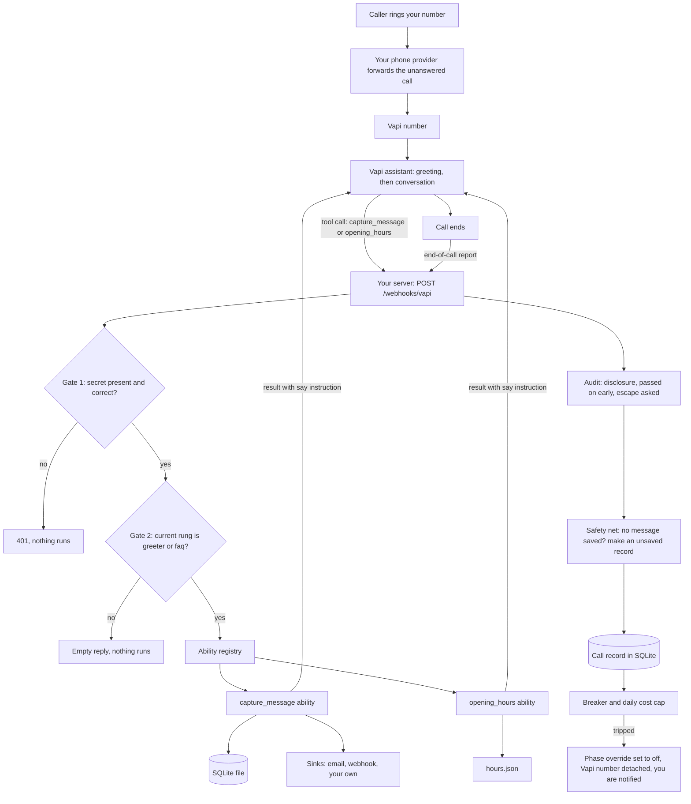

# Architecture

A high-level view of how phone-ai works. For setup steps, see [SETUP.md](SETUP.md). For word meanings, see [GLOSSARY.md](GLOSSARY.md).

## The shape of it

phone-ai is one small Node/TypeScript server (Express) plus a few command-line scripts. It does not handle audio. [Vapi](GLOSSARY.md#vapi) handles the call, the speech and the language model. Vapi calls your server over HTTPS for two reasons: to run a tool during the call, and to report when the call ends.

## A call, step by step



In words:

1. A caller rings your number. Your phone provider forwards the call to your Vapi number when you do not answer.
2. Vapi starts your assistant. It speaks the first line, which always says it is an automated assistant and that calls are recorded.
3. The language model talks to the caller. When it wants to save a message or read the hours, it asks Vapi to run a tool.
4. Vapi sends a `tool-calls` request to `/webhooks/vapi` on your server.
5. The server checks the two gates, finds the ability, runs it and replies. The reply includes a `say` instruction in plain words that tells the model what to do next.
6. When the call ends, Vapi sends an `end-of-call-report`. The server audits the transcript, applies the safety net, stores a call record, then updates the breaker and the daily cost cap.

## The two gates

Either one alone keeps the system inert.

| Gate | Where | What it does |
|---|---|---|
| 1. Secret | `src/server.ts`, `src/webhook.ts` | The `/webhooks/vapi` route is only mounted when a webhook secret is set. The secret is checked before any request body is read and before the database is touched. The check fails closed: no secret, or no matching header, means reject. It compares in constant time. |
| 2. Rung | `src/webhook.ts`, `src/ladder.ts` | Tool calls do nothing unless the phase in force is customer-facing (`greeter` or `faq`). The phase in force is the configured `PHONEAI_PHASE`, lowered (never raised) by any stored override from the breaker or the kill switch. |

## The ability contract

An ability is one tool the AI may call. Each lives in `src/abilities/<name>/index.ts` and satisfies the `Ability` interface in `src/abilities/types.ts`.

| Field | Meaning |
|---|---|
| `name`, `description` | Human labels. |
| `minPhase` | The lowest rung this ability may run on. |
| `enabled` | `false` means a documented stub. It is never offered to the model and never runs. |
| `tool` | The tool definition the model sees (name, when to use it, its arguments). |
| `handle(args, ctx)` | Does the work and returns `{ status, result }`. |

The rules every ability follows:

- It never throws. (The server also catches throws and tells the model something went wrong, so the model never claims a save that did not happen.)
- It states no fact it did not get from a real source.
- Its `result.say` is an instruction to the model, not a script to read aloud.
- It does not ship without a guardrail check and a break-it scenario in the robot.

The registry (`src/abilities/index.ts`) only offers abilities that are both `enabled` and allowed on the current rung. If the model calls a tool that is not offered, the server answers "that is not something you can do, say nobody is free and take a message".

### Abilities in v1

| Tool name | Folder | State | What it does |
|---|---|---|---|
| `capture_message` | `take_message` | On | Saves a confirmed message. |
| `opening_hours` | `store_hours` | On | Reads open/closed and the week's hours from your `hours.json`. |
| `order_status` | `order_status` | Stub, off | Planned. Needs caller verification first. |
| `transfer_to_human` | `transfer_to_human` | Stub, off | Planned. Needs a real destination and a tested fallback. |
| `book_callback` | `book_callback` | Stub, off | Planned. Needs a real calendar. |

The folder names differ from the tool names for two of them. The tool name (the one Vapi and the tests use) is what matters.

## How to add an ability

1. Copy `src/abilities/_template/` to `src/abilities/<your_ability>/`.
2. Rename `name` and the tool name. Set `minPhase`. Write the tool description for the model: when to call it and when not to.
3. Implement `handle`. Return facts only from a real source. Never throw.
4. Import it and add it to `ALL_ABILITIES` in `src/abilities/index.ts`. (`_template` is deliberately not registered.)
5. Add a scenario in `robot/scenarios/` with at least one break-it case: a caller trying to make it lie, skip a check, or reach something it should not.
6. Keep `enabled: false` until the scenarios pass and you have read real test-call transcripts.
7. Check `src/guardrails.ts`. If your ability changes what the AI may say, update `HARD_RULES` and the tests that pin it.

The full rules for earning a place are in [ROADMAP.md](ROADMAP.md).

## Where state lives

One SQLite file (default `./data/phone-ai.sqlite`), using Node's built-in `node:sqlite`. Three tables:

| Table | Holds |
|---|---|
| `messages` | One row per call: the message the caller left (or the unsaved safety-net record). |
| `calls` | One row per ended call: duration, cost, transcript, summary, and the audit flags. |
| `kv` | Small settings: the phase override, the reason for it, and the times of recent failed calls. |

The daily cost is computed from the `calls` table (real calls only, by UTC date).

## Sinks and the Store

Two seams keep the core independent of any CRM:

- **Store** (`src/store.ts`) is the only thing that touches the database. To use another database, replace this class.
- **Sink** (`src/types.ts`, `src/sinks/`) is the delivery interface: `{ name, deliver(message) }`. Built in: an email sink and a webhook sink. `src/sinks/exampleCrm.ts` is a worked example for a ticketing system. Sinks run in parallel and a failure in one is logged and ignored.

Test calls (marked with the `phoneai_test` metadata set by `setup-vapi --test`) are stored but never delivered to sinks.

## File map

```
src/
  server.ts           Express app. /healthz, and /webhooks/vapi only if a secret is set.
  webhook.ts          Secret check, tool-call handling, end-of-call handling.
  config.ts           Settings. Order: environment, then config file, then default.
  ladder.ts           The rungs, and the phase in force.
  types.ts            Shared types: Phase, TakenMessage, CallRecord, Sink.
  guardrails.ts       Greeting, hard rules, banned phrases, escalation topic lists.
  audit.ts            End-of-call checks: disclosure, passed on early, escape asked.
  breaker.ts          Failure counting, daily cost cap, switch-off and detach.
  assistant.ts        Builds the Vapi assistant config and system prompt.
  vapiClient.ts       Thin wrapper over Vapi's REST API (three calls).
  store.ts            SQLite storage.
  hours.ts            Opening hours logic.
  phone.ts            Phone number and email checks (region aware).
  digest.ts           The daily review text.
  deps.ts, log.ts     Wiring and a small logger.
  abilities/          index.ts (registry), types.ts (contract), one folder per ability.
  sinks/              index.ts (email sink, deliverAll), webhook.ts, exampleCrm.ts.
  notify/email.ts     SMTP notices. Falls back to the log if SMTP is not set.
  shadow/review.ts    The shadow rung: reviews a folder of .txt transcripts.
  cli/                setupVapi.ts, switch.ts, digest.ts.
robot/                Offline robot caller: runner.ts, run.ts, scenarios/*.json.
tests/                Automated tests (vitest).
examples/             hours.example.json, config example, sample transcript.
credentials/          phone-ai.env.example (copy to .env).
scheduling/           systemd and cron examples.
policy/               Ladder, guardrails and review checklist.
```
